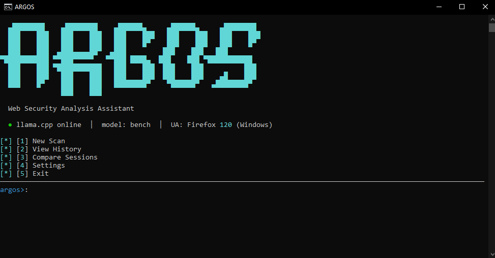

# ARGOS — Web Security Analysis Assistant

> **AI-powered terminal tool for web reconnaissance, vulnerability analysis, and exploit suggestion.**
> Built for penetration testers, security researchers, and developers who want deep automated recon with local LLM analysis.

---

## Disclaimer

> **ARGOS is intended for use ONLY on systems you own or have explicit written permission to test.**
> Unauthorized use against third-party systems is illegal in most jurisdictions.
> The author (Hemiize) assumes **no liability** for any misuse, damage, or legal consequences arising from the use of this tool.
> **You are solely responsible for how you use this software.**

---

## Features

| Feature | Details |
|---|---|
| **27-tool ultra deep scan** | Standard (5) → Deep (13) → Ultra (27) recon tools |
| **Local LLM analysis** | Runs entirely on-device via llama.cpp or Ollama — no cloud, no data leaks |
| **Live token/s display** | Streams LLM output with real-time token counter |
| **CVE enrichment** | NVD API v2 with 7-day local SQLite cache |
| **Deface detection** | Checks defacement signatures, shell paths, WebDAV write access |
| **Payload execution** | Allowlisted exploit runner (nmap, sqlmap, nikto, curl, dirb…) |
| **AI exploit analysis** | LLM interprets raw tool output — shows success/fail + verdict + evidence |
| **PDF/HTML/JSON/Markdown export** | Professional reports for each scan session |
| **Follow-up chat** | Interactive Q&A with the LLM about scan results |
| **Session management** | SQLite history, diff between sessions, resume interrupted scans |
| **Proxy & Auth support** | Route via Burp/ZAP, inject cookies or HTTP Basic Auth |
| **Cross-platform** | Windows (PowerShell) + Linux — no cloud dependency |

---

## Scan Modes

| Mode | Tools | Time | Use Case |
|---|---|---|---|
| **Standard** | nmap, whois, whatweb, HTTP headers, DNS | ~2 min | Quick initial fingerprint |
| **Deep** | + SSL, security headers, WAF, CMS, subdomains, dir enum, nikto, CT logs, JS secrets, banner grab | ~10 min | Full surface mapping |
| **Ultra Deep** | + SQLi probe, XSS probe, CORS audit, clickjacking, open redirect, deface detect, path traversal, info disclosure, full nmap vuln scripts | ~30 min | Comprehensive vulnerability assessment |

---

## Screenshots

> *Terminal UI powered by [Rich](https://github.com/Textualize/rich)*



---

## Requirements

### Software
- Python 3.10+
- [nmap](https://nmap.org/download.html) (add to PATH — required for port scanning)
- One of:
  - [llama.cpp server](https://github.com/ggerganov/llama.cpp) (`llama-server`) with a GGUF model
  - [Ollama](https://ollama.com/) with any supported model

### Python packages
Installed automatically by `setup.bat` / `pip install -r requirements.txt`:
```
rich, requests, beautifulsoup4, dnspython, python-whois, reportlab, duckduckgo-search, ddgs
```

---

## Installation

### Windows (recommended)

```bash
git clone https://github.com/Hemiize/argos.git
cd argos
setup.bat
```

### Linux / macOS

```bash
git clone https://github.com/Hemiize/argos.git
cd argos
python3 -m venv venv
source venv/bin/activate
pip install -r requirements.txt
```

---

## Recommended Models

> **ARGOS performs significantly better with uncensored or abliterated models.**
> Standard safety-tuned models often refuse to generate exploit commands, suggest payloads, or describe vulnerabilities in detail — which is exactly what ARGOS needs to be useful.

### Recommended

| Model | Backend | Notes |
|---|---|---|
| **Llama-3-based abliterated** (e.g. `Llama-3.1-8B-Lexi-Uncensored`) | llama.cpp / Ollama | Great balance of speed and quality |
| **Mistral-based uncensored** (e.g. `Mistral-7B-Instruct-v0.2-Uncensored`) | llama.cpp / Ollama | Fast, good for structured JSON output |
| **WizardLM-uncensored** | llama.cpp / Ollama | Strong at following complex instructions |
| **Any abliterated Qwen2.5 / DeepSeek** | llama.cpp / Ollama | Excellent reasoning, handles long recon data well |

> **What is an abliterated model?**
> Abliteration removes the refusal direction from the model's weights without fine-tuning, preserving general capability while eliminating safety restrictions.
> Find models on [Hugging Face](https://huggingface.co/) — search for `uncensored`, `abliterated`, or `lexi`.

### Not recommended
Censored models like default `llama3`, `mistral`, or `phi` will refuse to suggest exploits, write payloads, or analyse vulnerabilities — rendering most of ARGOS's AI features useless.

---

## Configuration

Edit `config.py` to match your LLM setup:

```python
# llama.cpp
LLAMA_URL   = "http://localhost:8080/v1/chat/completions"
LLAMA_MODEL = "bench"   # model id as reported by /v1/models

# Ollama
OLLAMA_URL   = "http://localhost:11434/api/chat"
OLLAMA_MODEL = "llama3"
```

Or configure at runtime via **Settings → [1] LLM Backend**.

---

## Usage

### Windows
```bash
start.bat
```

### Linux / macOS
```bash
source venv/bin/activate
python argos.py
```

### CLI arguments
```bash
python argos.py --target example.com --depth 2
python argos.py --target 192.168.1.1 --depth 3 --proxy http://127.0.0.1:8080
python argos.py --target example.com --cookie "session=abc123" --auth admin:pass
```

| Argument | Description |
|---|---|
| `--target`, `-t` | Target IP or domain (skips the prompt) |
| `--depth`, `-d` | Scan depth: `1`=standard `2`=deep `3`=ultra |
| `--proxy`, `-p` | Proxy URL for all requests (e.g. Burp Suite) |
| `--cookie` | Raw Cookie header for authenticated scans |
| `--auth` | HTTP Basic Auth as `user:pass` |

### Starting your LLM server

**llama.cpp:**
```bash
llama-server -m your-model.gguf --port 8080 -c 16384
```

**Ollama:**
```bash
ollama serve
ollama run llama3-uncensored
```

---

## Menu Overview

```
[1] New Scan          — run standard / deep / ultra scan against a target
[2] View History      — browse past sessions, re-run exploits, export reports
[3] Compare Sessions  — diff two scans to track remediation progress
[4] Settings          — switch backend, model, user-agent, proxy, auth, CVE cache
[5] Exit
```

### Scan flow
1. Enter target IP or domain (or pass via `--target`)
2. Target reachability is verified before scanning begins
3. Choose depth (1 / 2 / 3)
4. ARGOS runs all recon tools in parallel with a live `[X/N]` progress counter
5. LLM analyses raw scan data with live token counter
6. Results displayed with severity-coloured panels
7. Optionally: execute payloads with AI-interpreted result, chat about results, export report

---

## Payload Execution Mode

After a scan, ARGOS offers to execute LLM-suggested exploits via an **allowlisted runner**:

```
Allowed tools: nmap, sqlmap, nikto, dirb, gobuster, wfuzz, hydra, curl, whatweb, ffuf, nuclei
```

The local LLM then interprets the raw tool output and displays a clean result:

```
╭─── SQL Injection Test ────────────────────────────────────────────╮
│ ✔  ERFOLG                                                         │
│                                                                    │
│ Ergebnis  : Parameter ?id is vulnerable to UNION-based SQLi       │
│ Beweis    : "you have an error in your SQL syntax"                │
│ Severity  : CRITICAL                                              │
│ Next step : sqlmap -u "…" --dbs --batch                           │
╰────────────────────────────────────────────────────────────────────╯
```

- `curl` commands are routed through Python `requests` (no curl binary needed on Windows)
- Target placeholders (`{target}`, `TARGET`, `example.com`) are auto-substituted
- Results saved to the session database

> **Only run this against targets you own or have written permission to test.**

---

## Export Formats

From **View History → [session] → Export**:

| Format | Contents |
|---|---|
| **PDF** | Professional report with tables, severity colours, AI analysis |
| **HTML** | Dark-themed standalone web page |
| **JSON** | Machine-readable structured export |
| **Markdown** | GitHub-compatible report |

---

## Project Structure

```
argos.py        — main entry point, menu logic, CLI args
config.py       — paths, URLs, timeouts, default scan depth
settings.py     — user settings (backend, model, proxy, auth, wordlists)
llm.py          — LLM bridge (llama.cpp + Ollama, streaming, exploit analysis)
tools.py        — 27 recon tool runners, _SessionFactory, validate_target
ui.py           — Rich terminal UI components
db.py           — SQLite session database, scan resume
cve.py          — NVD CVE enrichment
export.py       — PDF, HTML, JSON, Markdown report generation
search.py       — DuckDuckGo web search helper
requirements.txt
setup.bat       — Windows setup script
start.bat       — Windows launcher
```

---

## Security Notes

- All analysis is performed **locally** — no scan data is sent to any cloud service
- The LLM runs entirely on your hardware (llama.cpp / Ollama)
- NVD CVE lookups contact `services.nvd.nist.gov` only (cacheable offline after first run)
- DuckDuckGo search is optional and only used in the follow-up chat search feature

---

## License

This project is licensed under the **MIT License with Attribution Requirement**.

You are free to use, modify, and distribute this software **provided that**:
- You include the original copyright notice, AND
- **You visibly credit the author: Hemiize** (e.g. "Based on ARGOS by Hemiize")

See [LICENSE](LICENSE) for full terms.

---

## Author

**Hemiize**

---

*ARGOS — stay legal.*
